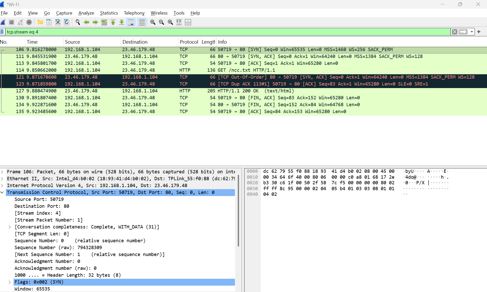
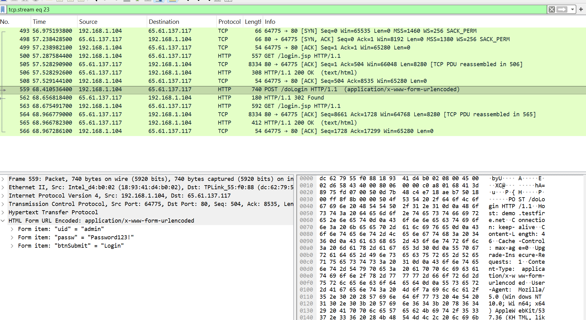
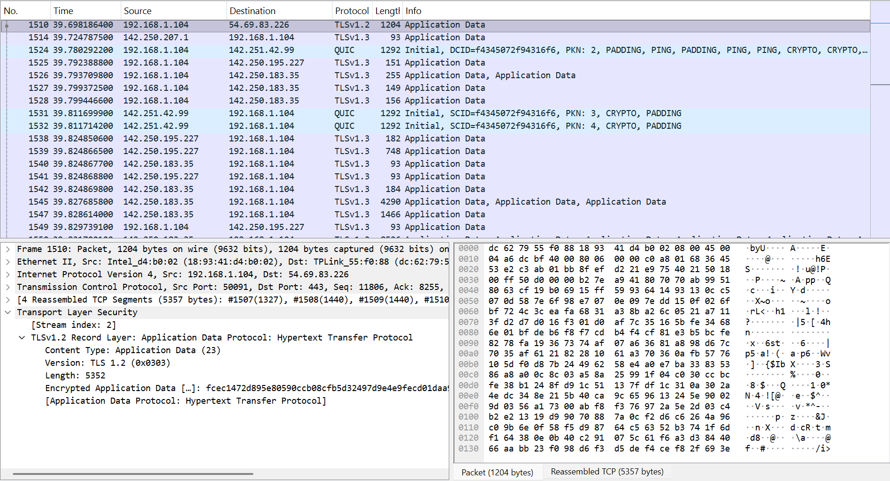
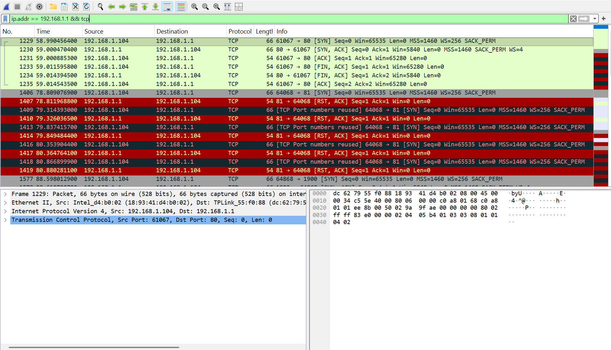

### Wireshark Lab: Network Protocol and Traffic Analysis

A hands-on network analysis lab investigating protocol behavior, cleartext data exposure, and transport-layer connection states using Wireshark.

The exercises were conducted on a Windows host using controlled network interactions to evaluate packet-level evidence. Scenarios covered foundational protocol flow (DNS, TCP handshake, session lifecycle), security risks of unencrypted HTTP authentication, and TCP handshake behavior under open versus closed port conditions.

### Objectives
- Capture and analyze local network traffic using Wireshark display filters.
- Trace and document protocol sequences including DNS resolution and TCP session establishment/teardown.
- Evaluate the security implications of cleartext application protocols (HTTP) compared to encrypted transport (TLS).
- Observe and verify TCP connection states (SYN/ACK vs. RST/ACK) using targeted port probing.
- Document network findings with defensible technical accuracy, distinguishing verified packet data from unobserved metadata.

### Lab Environment
| Component | Configuration |
|---|---|
| Host Platform | Windows laptop (`192.168.1.104`) |
| Capture Tool | Wireshark v4.x (Npcap driver) |
| Monitored Interface | Wi-Fi network interface |
| Probing Utility | PowerShell (`Test-NetConnection`) |
| Local Gateway Target | `192.168.1.1` (Default Gateway) |
| Demonstration Target | `demo.testfire.net` (`65.61.137.117`) |

---

### Traffic Analysis Scenarios

#### 1. Baseline Protocol Flow: DNS & TCP Session Lifecycle
**Purpose:** Verify fundamental name resolution and transport-layer connection mechanics.

I captured DNS queries and responses along with standard web browsing traffic, isolating conversations using Wireshark display filters (`dns`, `tcp.stream eq 4`, `ip.addr`).

**Verified Observations:**
- **DNS Resolution:** Verified standard recursive query/response transactions over UDP port 53 to gateway `192.168.1.1`. Inspection of the DNS payload confirmed mapped `A` (IPv4) records corresponding to requested domains (e.g., resolving `www.instagram.com` to `157.240.8.174`).
- **TCP Three-Way Handshake:** Observed sequence synchronization across client (`192.168.1.104`) and server:
  1. Client sends `[SYN]` (Sequence Number `0`, MSS, SACK permitted).
  2. Server responds with `[SYN, ACK]` (Acknowledgment Number `1`).
  3. Client acknowledges with `[ACK]`, transitioning the session state to `ESTABLISHED`.
- **Session Termination:** Traced graceful connection teardown using bidirectional `[FIN, ACK]` frames, followed by final client acknowledgment.

*Figure 1: Complete TCP stream lifecycle (tcp.stream eq 4) showing the initial three-way handshake ([SYN], [SYN, ACK], [ACK]), HTTP GET/200 OK data exchange, and graceful teardown ([FIN, ACK], [ACK]).*

**Interpretation:** Baseline packet analysis confirms proper protocol compliance and establishes normal operational benchmarks required before identifying anomalies or unauthorized communications.

---

#### 2. Cleartext Transmission vs. Transport Encryption
**Purpose:** Evaluate exposure of sensitive user input in unencrypted HTTP traffic versus TLS session security.

I submitted test credentials containing dummy authentication data (`uid=admin`, `passw=Password123!`) to a public demonstration banking application (`demo.testfire.net` on IP `65.61.137.117`) over standard HTTP port 80, and compared the capture against subsequent encrypted HTTPS/TLS 1.2+ traffic.

**Verified Observations:**
- **HTTP POST Analysis:** Using Wireshark's stream isolation (`tcp.stream eq 23`), packet 559 captured the cleartext HTTP `POST /doLogin` request. Expanding the `HTML Form URL Encoded` payload exposed all submitted parameters:
  - Form field `uid`: `"admin"`
  - Form field `passw`: `"Password123!"`
  - Form field `btnSubmit`: `"Login"`
- **TLS Comparison:** Under HTTPS/TLS 1.2 (port 443), the same user interaction encapsulated application data into opaque TLS records (`Application Data`, Content Type 23). The payload contents, HTTP headers, and submitted parameters were completely concealed from passive packet inspection.

*Figure 2: Inspection of Frame 559 to demo.testfire.net revealing plain-text credentials (admin / Password123!) exposed inside the unencrypted HTML Form URL Encoded payload.*

*Figure 3: Inspection of TLS 1.2 traffic showing application layer payload completely encapsulated inside opaque Application Data records (Content Type 23).*

**Interpretation:** Cleartext HTTP exposes sensitive application data to trivial interception on the local network segment. Transport Layer Security (TLS) prevents payload exposure, restricting passive network observation to packet headers, IP endpoints, and negotiated TLS parameters.

---

#### 3. Transport-Layer Probing: Open vs. Closed Port States
**Purpose:** Observe packet-level responses during controlled TCP connection attempts to open and closed service ports.

Using PowerShell's `Test-NetConnection` cmdlet, I initiated controlled single-port probes from the Windows host (`192.168.1.104`) to the local gateway router (`192.168.1.1`) across three specific ports:
- Port `80` (HTTP web management interface)
- Port `81` (Closed / unassigned port)
- Port `82` (Closed / unassigned port)

**Verified Observations:**
- **Port 80 (Open Service):** Packets 1229–1231 show the gateway immediately returned `[SYN, ACK]` in response to the client's `[SYN]`, completing the three-way handshake (`SYN` -> `SYN, ACK` -> `ACK`), followed by immediate teardown.
- **Port 81 (Closed Service):** In response to the client's initial `[SYN]` (Packet 1406), the gateway immediately returned a packet with reset and acknowledgment flags set (`[RST, ACK]`, Packet 1407).
- **Port 82 (Closed Service):** Packets 1601–1602 confirmed identical rejection behavior, returning `[RST, ACK]` upon receiving the probe.

*Figure 4: Wireshark capture of targeted probes to 192.168.1.1 filtered by `ip.addr == 192.168.1.1 && tcp`: Port 80 responds with [SYN, ACK] (open service), while Port 81 returns an immediate [RST, ACK] (closed service).*

**Interpretation:** 
- A listening TCP service accepts connection requests by returning `SYN, ACK`.
- An active host with no service bound to a queried port explicitly rejects the attempt by terminating with `RST, ACK`.
- This controlled exercise demonstrated exact transport-layer signaling under individual port queries, rather than an automated port scan.

---

### Results Summary
| Scenario | Target | Protocol / Flags | Recorded Packet Evidence |
|---|---|---|---|
| DNS & Handshake | Internet endpoints | DNS / TCP (`SYN`, `FIN`) | Mapped A-records; completed 3-way handshake and 4-step teardown |
| Cleartext Authentication | `demo.testfire.net` | HTTP (`POST`) | Plaintext form fields (`uid=admin`, `passw=Password123!`) visible in Frame 559 |
| Encrypted Session | HTTPS targets | TLS 1.2 | Encrypted Application Data payload (Type 23); content concealed |
| Gateway Probe: Port 80 | `192.168.1.1` | TCP (`SYN` / `SYN, ACK`) | Full handshake completed; web service listening |
| Gateway Probe: Ports 81/82 | `192.168.1.1` | TCP (`SYN` / `RST, ACK`) | Immediate connection reset (`RST, ACK`); ports confirmed closed |

---

### Key Takeaways
- **Packet-Level Grounding:** Protocol analysis in Wireshark provides ground-truth visibility into network communications, bypassing higher-level application abstractions.
- **Risks of Unencrypted Protocols:** Credentials and operational data transmitted across cleartext channels (HTTP) are fully exposed to passive eavesdropping.
- **Transport Diagnostics:** Observing TCP flag combinations (`SYN/ACK` vs. `RST/ACK`) provides precise diagnosis of service availability and network behavior without relying on proprietary scanner outputs.
- **Technical Precision in Reporting:** Clear distinction must be maintained between verified payload evidence (such as extracted HTTP fields) and encrypted traffic where only transport and network metadata remain accessible.

---

### Scope and Limitations
- The lab was conducted in a controlled home network environment using self-generated traffic and authorized demonstration endpoints (`testfire.net`).
- Testing focused on standard protocol evaluation and localized port probing; it did not encompass full automated vulnerability scanning, IDS/IPS evasion, or packet injection.
- Plaintext credential inspection was performed strictly using dummy values.

---

### Potential Follow-up Work
- Capture and analyze an active network scan (e.g., Nmap SYN stealth scan) to contrast automated scanning patterns against single manual probes.
- Inspect TLS 1.3 handshakes to evaluate privacy improvements over older TLS versions (e.g., Encrypted Extensions).
- Export and parse PCAP files using command-line utilities such as `tshark` for automated analysis workflows.
